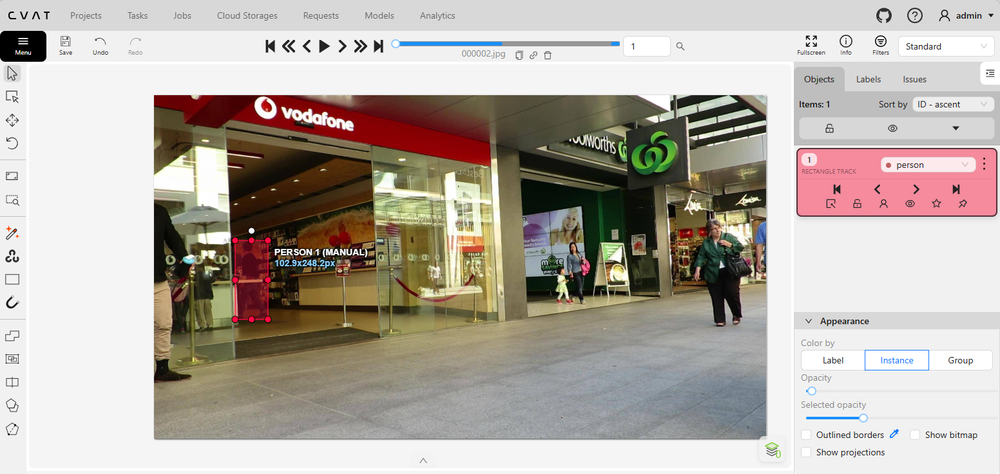
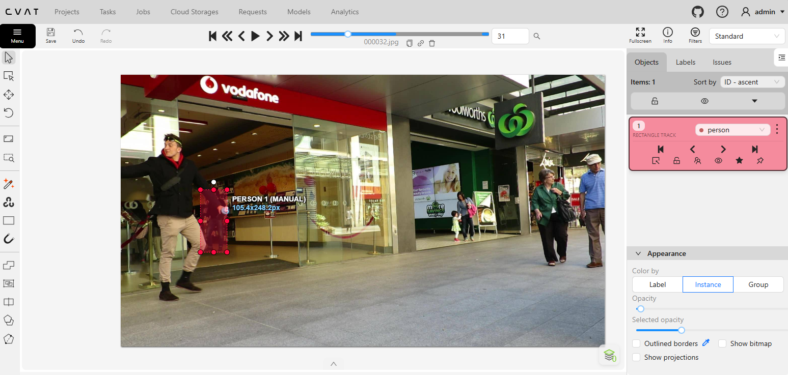
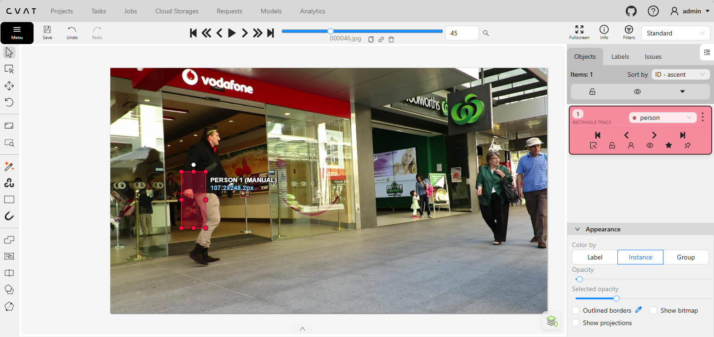

# Báo cáo cá nhân — HoVaTen-MSSV

Đổi tên file theo quy tắc `MSSV_HoTen.md`. Ví dụ: `20241234_NguyenVanAn.md`.

Đoạn video: MOT17-09, 150 frame (frame 1–150), nguồn MOTChallenge, giấy phép CC BY-NC-SA 3.0.

## 0. Thông tin học viên

- Họ tên:Nguyễn Khánh Trình
- MSSV:2A202603026
- Mã đề (A/B/C):B
- Email:26ai.trinhnk@vinuni.edu.vn
- Link repository: https://github.com/khanhtrinhkt2014/K5-L2-DAY05-NguyenKhanhTrinh-2A202603026-MOTTracking.git
- Giờ bắt đầu: 13:20 ngày 13/11/2026 (GMT+7)
- Giờ kết thúc: 15:30 ngày 13/11/2026 (GMT+7)

## 1. Xem trước đoạn video (CP0)

Ghi **trước khi vẽ**, mỗi người một dòng.

| Mã | Frame xuất hiện | Frame cuối thấy được | Rẽ / dừng / đổi tốc độ ở frame | Bị che ở frame | Ghi chú |
|---|---|---|---|---|---|
| P1 | 0 | 149 | 77 | Khuất hoàn toàn 39–44; 7 frame che một phần cần xác định mốc | Người trong cửa hàng Vodafone; hiện lại ở frame 45 |
| P2 | 0 | 149 | 21 | Không có | Người áo xanh lá, mang túi đen |
| P3 | 0 | 149 | 51 | Không có | Người áo sơ mi xanh, đội mũ; đầu đoạn chỉ xuất hiện một phần ở mép phải |
| P4 | 0 | 146 | 36 | 108 | Em bé; có box trở lại ở frame 137, không còn box từ frame 147 |
| P5 | 0 | 105 | 38 | 95 | Người lớn đi cùng em bé, mang túi hồng; không còn box từ frame 110 |

## 2. Keyframe và thời gian (CP1, CP4)

Số keyframe lấy từ kết quả `src/check_submission.py`.

| Mã | Số keyframe | Keyframe ở frame | Số frame có mặt | Keyframe / 100 frame | Thời gian (phút) | Chỗ khó |
|---|---|---|---|---|---|---|
| P1 | 20 | 0, 4, 6, 9, 10, 11, 12, 20, 29, 30, 31, 36, 45, 55, 74, 84, 94, 104, 124, 134 | 144 | 13,9 | 25 | Người trong cửa hàng bị che; cần xác định mốc occluded/outside và giữ cùng ID khi hiện lại |
| P2 | 16 | 0, 10, 20, 30, 40, 50, 60, 70, 80, 90, 100, 110, 120, 130, 140, 149 | 150 | 10,7 | 15 | Đi gần P3, cần phân biệt hai người khi box chồng nhau |
| P3 | 16 | 0, 10, 20, 30, 40, 50, 60, 70, 80, 90, 100, 110, 120, 130, 140, 149 | 150 | 10,7 | 15 | Đầu đoạn chỉ thấy một phần người sát mép phải; cần chỉnh box khi người đi vào khung và bao đủ cánh tay |
| P4 | 7 | 0, 10, 20, 30, 40, 137, 140 | 120 | 5,8 | 15 | Em bé nhỏ trong ảnh; cần kiểm tra đoạn outside 110–136 và lúc hiện lại ở frame 137 |
| P5 | 7 | 0, 10, 20, 30, 40, 50, 100 | 110 | 6,4 | 15 | Cần kiểm tra cờ che một phần và thời điểm kết thúc track sau frame 109 |
| **Tổng** | **66** | — | **674** | **9,8** | **85** | — |

Keyframe / 100 frame của cả bài = tổng keyframe ÷ tổng số frame có mặt × 100
= 66 ÷ 674 × 100 ≈ 9,8.

Bạn đặt keyframe nhiều nhất ở người nào? Vì sao?

Tôi đặt nhiều keyframe nhất ở P1, với 20 keyframe. P1 có đoạn bị che khuất nên cần chỉnh box toàn thân ước lượng, xác định các mốc chuyển trạng thái occluded/outside và chỉnh box khi người xuất hiện trở lại, đồng thời giữ nguyên track ID.

## 3. Đoạn bị che (CP2)

Người bị che: `P_`

| Mốc | Frame |
|---|---:|
| Bắt đầu bị che một phần (bật `occluded`) | 29 |
| Mất hẳn (bật `outside`) | 39 |
| Hiện lại (tắt `outside`) | 45 |
| Thấy rõ trở lại (tắt `occluded`) | 50 |

- Thời gian khuất hẳn: 6 frame = 0,2 giây.
- Quyết định: giữ cùng ID.
- Lý do (trả lời 3 câu: khuất bao lâu so với 60 frame, ngoại hình có khớp, chỗ hiện lại có đúng hướng và tốc độ):

  - P1 khuất hoàn toàn trong 6 frame, nhỏ hơn ngưỡng 60 frame của lớp.
  - Trước và sau khi khuất, P1 có ngoại hình tương đồng: áo tối màu, quần xám và dáng người khớp nhau.
  - P1 xuất hiện lại trong khu vực cửa hàng Vodafone, gần vị trí trước khi bị người áo đen, quần be đi ngang che khuất.

Ảnh chụp màn hình:





## 4. Tự review ID (CP3)

Lượt 1 theo người (đi ngược từ frame 149 về 0 trên CVAT), lượt 2 theo cảnh (nhảy 10 frame). Ít nhất 3 dòng; không có lỗi thì ghi một dòng "đã kiểm hai lượt, không lỗi".

Loại lỗi dùng đúng một trong 7 mã: `id_switch`, `fragmentation`, `lost`, `merge`, `false_track`, `drift`, `flag`.

| Frame | Mã người | Loại lỗi | Mô tả một câu | Phát hiện ở lượt | Đã sửa? |
|---:|---|---|---|---|---|
| 0–149 | P1–P5 | — | Đã kiểm hai lượt, không lỗi. | Cả hai lượt | Không cần sửa |

Tổng hợp số lỗi theo loại:

| `id_switch` | `fragmentation` | `lost` | `merge` | `false_track` | `drift` | `flag` |
|---:|---:|---:|---:|---:|---:|---:|
| 0 | 0 | 0 | 0 | 0 | 0 | 0 |

Lỗi nào chỉ lượt 2 (theo cảnh) mới thấy, lượt 1 (theo người) không thấy? Vì sao?

Không có lỗi nào chỉ được phát hiện ở lượt 2. Sau khi kiểm tra theo từng người và theo toàn cảnh, tôi không phát hiện thêm lỗi.

## 5. File xuất và kết quả tự kiểm (CP4)

| Kiểm tra | Kết quả |
|---|---|
| Tên file MOT 1.1 | NguyenKhanhTrinh_mot.zip |
| Tên file CVAT for video 1.1 | NguyenKhanhTrinh_cvat_video.zip |
| Số track ID khác nhau trong `gt/gt.txt` (phải là 5) | 5 |
| Frame `outside` không có dòng trong `gt.txt` (đúng / sai) | Đúng — track 1 không có dòng tại frame CVAT 39–44 |
| Job đã completed trên CVAT máy cá nhân | Đã completed |

Dán phần tóm tắt in ra từ `src/check_submission.py`:

```text
=== Tóm tắt ===
  Lỗi: 0   |   Cảnh báo: 0
  Đạt. Dán phần tóm tắt này vào báo cáo mục 5.
```

## 6. Ba câu kết

1. Nếu được gán lại, bạn sẽ đặt keyframe khác ở đâu? Vì sao?

   Nếu được gán lại, tôi sẽ đặt thêm keyframe cho P1 tại frame 27 vì đây là lúc người bắt đầu bị che một phần. Tôi sẽ chỉnh box bao toàn thân ước lượng và bật occluded, giúp box bám đúng người khi đi vào đoạn che khuất.

2. Có chỗ nào bạn không chắc "cùng ID hay ID mới"? Bạn đã quyết định và ghi chú thế nào?

   Không có

3. Một lỗi ID trong job của bạn (nếu không còn sót, chọn lỗi đã sửa) có thể làm xe tự lái dự đoán sai chuyển động của người đó như thế nào? Lỗi đó ảnh hưởng MOTA hay IDF1 nhiều hơn?

   Cả MOTA và IDF1 đều có thể giảm. Việc giữ sai ID kéo dài thường thể hiện rõ hơn ở IDF1; mức giảm cụ thể phụ thuộc số frame và các lỗi khác.

## Bonus (nếu làm)

### B1 — Hai người đi sát

...

### B2 — So cách đặt keyframe

| Cách đặt | Số keyframe | Frame trôi nhất | Ghi chú |
|---|---:|---:|---|
| Đều mỗi 30 frame | | | |
| Theo chỗ đổi hướng | | | |

...

### B3 — So với tracker có sẵn

| Frame | Mã người | Tracker làm gì | Nhãn của bạn | Giải thích (đoán rồi sửa / ghép IoU / box score thấp / ngoại hình) |
|---:|---|---|---|---|
| | | | | |
| | | | | |

## 7. Tài liệu tham khảo và công cụ AI đã dùng

...
